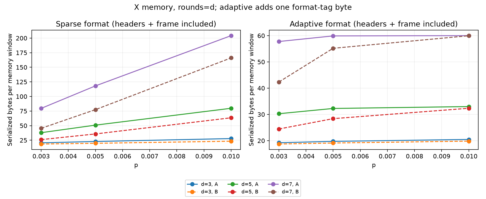

# Real-Time Quantum Error Correction Decoder

A reproducible surface-code decoder study with a DEM-supported local predecoder
and verified SystemVerilog prototype. **The first M0–M6 study is implemented and
measured.** It found communication savings, but no CPU speedup and some logical
accuracy degradation. There are no physical FPGA performance or power claims.

Read the [final report](reports/final_report.md), [status](reports/PROJECT_STATUS.md)
and [measurement methods](docs/research_methods.md).

The [F1 follow-up](reports/milestones/F1.md) tests a frozen guarded rule on fresh
samples. It meets the provisional accuracy tolerance but misses its 5% traffic
target and is not promoted to RTL. Its best adaptive saving is 4.00%, with no
observed baseline prediction disagreements over 1.2 million primary shots.

```powershell
# Small F1 pipeline check (separate smoke data):
.\.venv\Scripts\python.exe -m qec_project guarded --smoke
# Full registered F1 experiment (1.42 million shots):
.\.venv\Scripts\python.exe -m qec_project guarded
```

Inspect [accuracy](reports/evidence/F1/F1_accuracy.png),
[traffic](reports/evidence/F1/F1_bytes.png) and [CSV](reports/evidence/F1/results.csv)
without rerunning. The original M6 study and hardware results remain historical
evidence for the original rule, not verification of F1.

## See a result quickly

From this folder in Windows PowerShell:

```powershell
.\.venv\Scripts\python.exe -m qec_project demo --distance 3 --rounds 3 --p 0.005 --shots 1000 --seed 42
```

It prints a results directory containing CSV, a plot, circuit/DEM/config files
and samples. Logical failure probability is the fraction of whole memory windows
with an incorrect observable prediction, not a physical-gate or per-round error
rate. Error bars reflect sampling uncertainty. Zero observed failures is not perfect correction.



## Reproduce

```powershell
# Small software pipeline check, including tests and control experiments:
.\.venv\Scripts\python.exe scripts/reproduce.py --smoke --software-only

# Full study, independent Sinter check, selected RTL/synthesis, retiming and queues:
.\.venv\Scripts\python.exe scripts/reproduce.py

# Configurable software matrix only:
.\.venv\Scripts\python.exe -m qec_project study --config configs/research.json
```

The full run is larger than the demo: 36 points with 30,000 shots each, two local
policies, X/Z bases, d=3/5/7, rounds=d/2d and three noise levels. Hardware steps
require WSL2 Ubuntu with Verilator/Yosys/compiler. They run from Windows through
WSL without switching desktops. `--software-only` skips fresh RTL runs; archived
hardware charts then remain reference evidence. See [hardware instructions](rtl/README.md).
No GPU or FPGA purchase is required.

`study` writes accuracy, byte counts and initial timings. The reproduction script
also performs sequential retiming after builds/sampling stop and audits queues.
Open PNGs in an image viewer, CSV in Excel, and JSON in an editor.

## Install

Use Python 3.11+; the recorded Windows environment uses 3.12.14. If `python` is an
unavailable Windows alias, use `py -3` or an installed Python's full path.

```powershell
python -m venv .venv
.\.venv\Scripts\python.exe -m pip install -e '.[dev,research]'
.\.venv\Scripts\python.exe -m pytest
.\.venv\Scripts\python.exe -m qec_project --help
```

For tested pins on a compatible Python/platform, install requirements-lock.txt,
then `pip install --no-deps -e .`. The Linux RTL-only environment has a separate
requirements-rtl-lock.txt. Do not activate Windows .venv inside Ubuntu.

If this app restricts system temporary files:

```powershell
New-Item -ItemType Directory -Force results | Out-Null
$env:TMP = (Resolve-Path results).Path
$env:TEMP = $env:TMP
.\.venv\Scripts\python.exe -m pytest --basetemp=results/pytest-temp -q
```

The reproduction script sets its own temporary location. pytest clears only its
dedicated test directory on reruns. Generated samples, builds and environments
are ignored; compact reviewed evidence is committed.

## Architecture and interpretation

Stim generates noisy rotated surface-code memory experiments. Its detector
events feed PyMatching MWPM. Local preprocessing selects disjoint unambiguous
two-detector DEM mechanisms, XORs their support and records their logical frame.
The combined prediction is `frame XOR MWPM(residual)`. Unsupported local cases
remain for matching. Clearing detector bits without tracking the frame is invalid.

The unrestricted policy makes more decisions. The strict policy only preprocesses
windows with at most two events. Both are heuristics; equal observed failures is
not equivalence. A scalar Python golden rule, tested NumPy batch kernel, and
generated fixed-graph RTL implement the same unrestricted rule. RTL buffers one
complete output window; it is not a round-by-round quantum controller.

Gate/data/measurement/reset noise is explicit. --p sets each channel, not an
aggregate circuit error probability. Basis, distance and rounds are independent.
Seeds, versions, saved samples, hashes and Git provenance support reproducibility;
bitwise identity across tool versions/platforms is not promised.

Batch CPU throughput, individual-window latency, modeled transport/queue time,
RTL cycles and generic synthesis counts are separate metrics. No achieved FPGA
frequency, physical speedup, target resource mapping or power is reported.

## Other commands and layout

- `--smoke --config configs/smoke.json`: infrastructure manifest only.
- `demo`: one experiment; `sweep`: original fixed M1 grid.
- `study --config ...`: configurable M6 software matrix.
- `benchmark --replay RUN/0`: M2 workload replay on demo samples.
- `compare --replay RUN/0`: original scalar M3 comparison.
- `model --replay RUN/0`: original optimistic M4 batch-average queue model.

Use M6's reproduction workflow for final queue conclusions, rather than treating
M4 batch averages as single-window feedback latency. `src/qec_project/` contains
research code, `configs/` settings, `tests/` correctness checks, `scripts/`
reproduction tools, `rtl/` the hardware testbench/interface, and `reports/` results
and milestone history. MIT licensing permits reuse with attribution.
