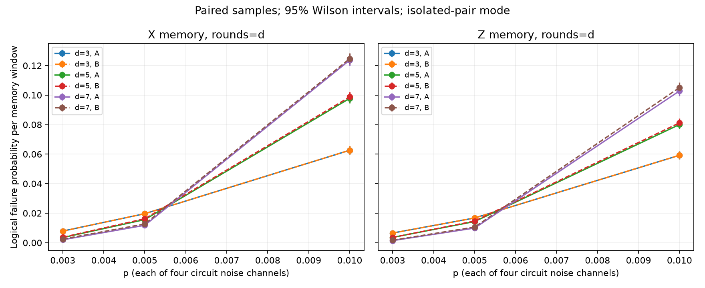
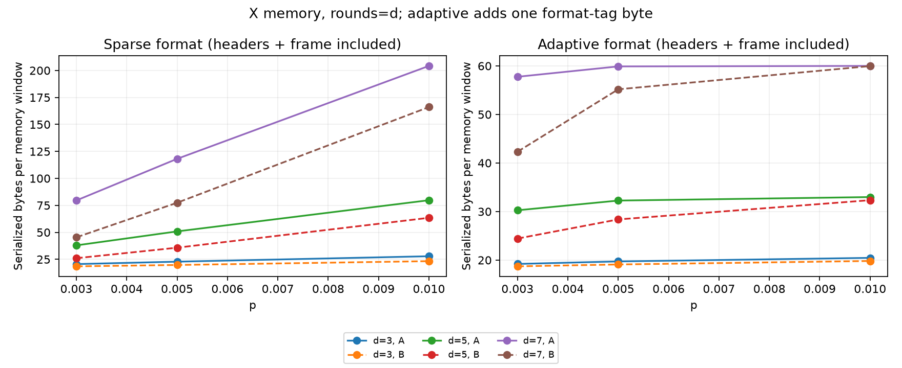
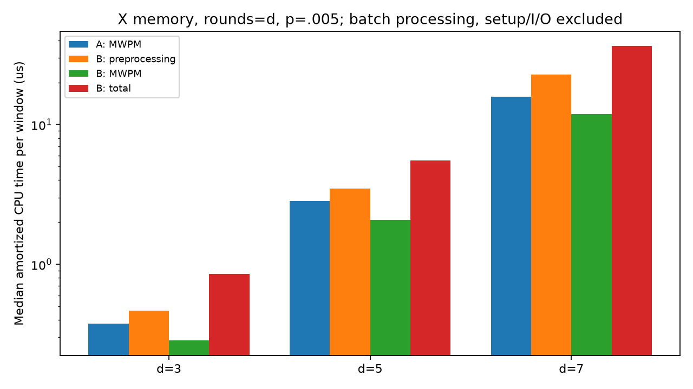
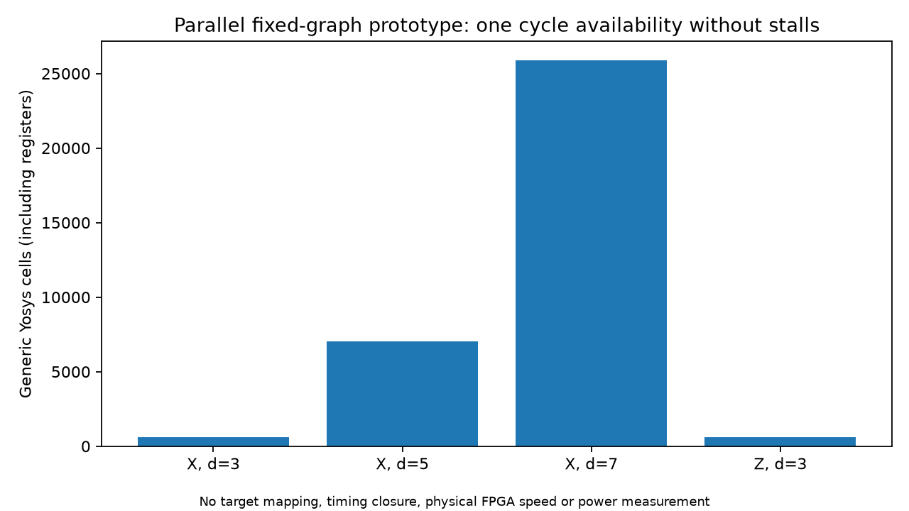
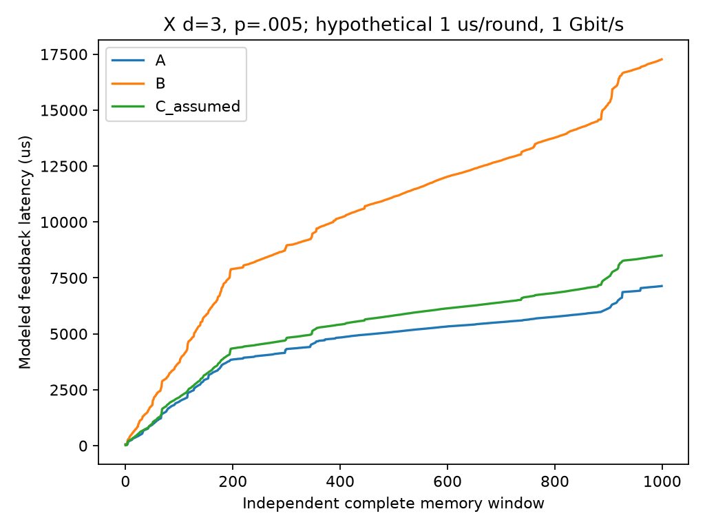

# Real-Time Quantum Error Correction Decoder with Hardware–Software Co-Design

## Abstract

We evaluated a conservative local predecoder ahead of PyMatching for offline
rotated surface-code memory experiments. A 36-point study sampled 1,080,000
windows, comparing both decoders on identical detector events and true logical
observables. Unrestricted isolated-pair preprocessing reduced sparse traffic by
9.2–47.7%, but reduced adaptive dense/sparse traffic by only 0–28.3%. It increased
logical failures at several points and did not improve measured total CPU time.
A stricter two-event-window policy had no observed prediction disagreements,
with much smaller traffic reductions. Generated SystemVerilog matched the Python
hybrid on 120,000 replayed shots across four fixed graphs. Generic synthesis
grew from 602 cells at distance 3 X to 25,869 at distance 7 X. These are simulation
and generic synthesis results, not measured FPGA latency, frequency, power or speedup.

## Hypothesis and scope

The hypothesis was that inexpensive local correction decisions could reduce the
communication and global matching burden without unacceptable logical error.
Architecture A is Stim sampling followed by full PyMatching MWPM. B uses local
preprocessing, residual MWPM and an accumulated logical frame. C replaces the
local rule with functionally equivalent simulated RTL and retains CPU MWPM.

The surface code protects a logical degree of freedom using redundant physical
qubits and repeated parity measurements. Detector events are unexpected parities
defined by Stim, not raw measurement bits. A decoder estimates the logical frame;
the experiment scores its predicted observable flips against sampled true flips.
Larger code distance can improve protection in suitable noise regimes, but also
creates more classical data and a larger decoding graph.

This study simulates complete memory windows. It does not implement arbitrary
fault-tolerant gates, a QPU controller, or a decoder that finalizes corrections
immediately after each syndrome round.

## Code and noise model

The main grid uses X and Z rotated memory tasks, distances 3/5/7, rounds=d or 2d,
and p=.003/.005/.01. Each of 36 points has 30,000 shots and its own recorded seed.
All four Stim generator probabilities equal p: after-Clifford depolarization,
before-round data depolarization, before-measurement flips and after-reset flips.
p is not the aggregate chance of any physical fault in a round or circuit.

PyMatching uses the decomposed detector error model. Correlation-aware decoding
is not enabled. The same circuit, noise model, sampled detector matrix and true
observable matrix are used for each A/B comparison. Configs, seeds, versions,
circuit/DEM hashes and source revisions are archived with the results.

## Predecoder and validity controls

Local candidates are whole two-detector DEM mechanisms with an unambiguous
logical mask. Correlated decompositions, hyperedges and conflicting local masks
are excluded. Boundary cases fall back to MWPM. Among candidates whose endpoints
both fire, only mutually exclusive isolated pairs are selected. The residual
syndrome XORs selected detector supports; selected logical masks are XORed into
the predecoder frame. Final prediction is frame XOR residual-MWPM prediction.
Exclusivity ensures disjoint bookkeeping, not physical correctness of the guess.

Two policies are compared: unrestricted isolated pairs, and the same rule only
for complete windows containing at most two detector events. Windows above that
limit fall back entirely to MWPM. A chunked NumPy kernel executes the scalar rule
for batches; scalar/batch equivalence is checked on real samples and randomized
multi-observable cases. Algebraic tests enumerate every zero/one/two/three-event
syndrome of distance-3 X/Z graphs and verify correction reconstruction.

Forty thousand additional control shots cover noiseless and p=.1 X/Z experiments
at distance 3. Both decoders had zero failures in each 10,000-shot noiseless case;
the two-sided exact 95% upper bound is approximately 0.000369 per window, not zero
physical failure probability. At p=.1 the unrestricted rule changed failures:
X 4,941->4,965 and Z 4,867->4,876 out of 10,000. The strict rule retained baseline
predictions. These stress points do not establish a useful high-noise operating regime.

An independent Sinter Monte Carlo replication of X d=3, rounds=3, p=.005 found
596/30,000 failures, with exact interval approximately [1.832%,2.151%]. The custom
harness found 590/30,000 at that point. The intervals are consistent. Sinter uses
the same MWPM backend, so this checks independent sampling/harness operation,
not an independently designed decoding algorithm. Its internal seed is not controlled.

## Statistical results

Failure probability is per whole memory window. We report 95% Wilson intervals,
exact zero-failure bounds, discordant shot counts and conservative paired intervals.
The paired interval subtracts two 97.5% exact binomial intervals for A-only and
B-only failures; Bonferroni gives at least 95% coverage for the difference.
It remains nonzero when no disagreements occur. Intervals are pointwise in an
exploratory grid, with no global multiple-comparison claim or equivalence margin.

Selected X-memory results at p=.005, rounds=d:

| Distance | Shots | A failures | Unrestricted B/C failures | Strict B failures |
|---|---:|---:|---:|---:|
| 3 | 30,000 | 590 | 590 | 590 |
| 5 | 30,000 | 470 | 487 | 470 |
| 7 | 30,000 | 354 | 381 | 354 |

At d=7 the observed rate changes from 1.18% to 1.27%; the paired increase is
0.09 percentage points, with conservative pointwise interval approximately
[0.0056,0.1741] percentage points. At d=5 the corresponding paired interval
includes zero. Eight of the 36 unrestricted comparisons have a positive paired
interval. Across the grid there are 1,826 B-only failures and 1,090 A-only failures;
these totals describe a mixture of different experiments, not a single physical
failure probability. Failure traces record exact detector supports, corrections,
frames and A/B/truth observables in [failure_cases.csv](evidence/M6/failure_cases.csv)
and [failure_cases.json](evidence/M6/failure_cases.json).

The strict policy has no observed A/B prediction disagreements over 1,080,000
main-study shots. This does not prove equivalence. In particular, its limited
traffic benefit at large/high-noise windows reflects frequent fallback.



The curves are memory-experiment comparisons, not a threshold measurement.
The full CSV includes both window lengths and policies; the figure selects rounds=d.

## Communication and measured software performance

The wire schema includes a 16-byte window/round/count header and a byte-rounded
logical frame for both architectures. Dense data is bit-packed; sparse indices
are uint32. Adaptive format includes an explicit one-byte tag and the shorter
of the two records. Actual records are constructed and roundtrip tested.
Physical link framing, CRC and negotiated connection metadata are outside this schema.

For X d=3, p=.005, sparse traffic averages 22.821->19.755 bytes/window under the
unrestricted rule, while adaptive traffic changes only 19.724->19.098. At d=7,
sparse traffic changes 118.105->77.421, but adaptive traffic changes 59.896->55.180.
Dense detector size is unchanged by simply clearing events. Thus event-count
reduction substantially overstates some communication gains.



The CPU was an Intel Core i7-1260P, with 16 logical processors visible, running
Windows Python 3.12.14. It was a shared, unpinned laptop. After sampling and RTL
builds finished, a separate sequential timing replay warmed up each point and
performed five alternating A/B trials on 2,048 fixed windows. Batch results are
amortized per window and exclude sampling, setup, serialization and I/O.

Unrestricted B's median batch time divided by A's ranges 1.45–4.24, with median
ratio 2.38 across points. Strict B's corresponding median ratio is 2.84. Neither
policy wins on total measured batch CPU time at any main-grid point in this run.
For X p=.005, rounds=d, median A/B times are approximately .376/.853 us at d=3,
2.841/5.531 us at d=5, and 15.820/36.380 us at d=7. The predecoder can reduce MWPM
work while adding more preprocessing overhead than it saves.



Separate 1,000-window timing distributions include scalar preprocessing,
serialization and decoding. Their p50/p95/p99 are in the CSV; they must not be
confused with batch-amortized times. Timer overhead, shared-system noise and the
small tail sample limit precise latency conclusions. CPU time and array sizes
are recorded; array bytes are not total resident memory. No physical feedback
or memory-bandwidth performance was measured.

## RTL verification and resources

The DEM-specialized RTL uses parallel candidate selection and a one-entry elastic
valid/ready output buffer. Backpressure holds data, simultaneous input/output is
allowed, and synchronous reset flushes pending output. Full-window input is
parallel; there is no physical serial interface or deep hardware FIFO.

For X d=3/5/7 and Z d=3 at p=.005, the simulator's actual residual/frame outputs
were collected for 30,000 saved study shots per graph and passed through CPU MWPM.
All 120,000 C predictions matched B, including the unfavorable logical outcomes.
This verifies the implementation of the heuristic, not the safety of that heuristic.
Synthetic pair/dense vectors, stalls, bubbles and reset cases were also checked.

| Graph | Detectors | Generic cells | Register bits |
|---|---:|---:|---:|
| X d=3 | 24 | 602 | 25 |
| X d=5 | 120 | 7,055 | 121 |
| X d=7 | 336 | 25,869 | 337 |
| Z d=3 | 24 | 597 | 25 |



Tools were cocotb 2.1.0, Verilator 5.032 and Yosys 0.52 inside WSL2 Ubuntu.
Unstalled output availability and initiation interval are each one architectural
cycle. The 10 ns test schedule does not establish an achievable 100 MHz design.
No target mapping, timing closure, physical FPGA area, power or deployment result
exists. Parallel graph expansion has a visible resource-scaling cost.

## Hypothetical service and queue model

The queue study replays measured scalar stage distributions through distinct
front-end, transfer and MWPM resources. Independent windows arrive every rounds
times a hypothetical round period. Window-fill time is included; additional terminal
measurement time is assumed zero. Capacity is audited per stage including service.
Unlimited replay drops nothing; capacity violations mark finite-buffer infeasibility.

There are 1,080 scenarios across the main grid/policies, 1/10/100 us assumed round
periods, 100 Mbit/s or 1 Gbit/s links, a 1 ms window-start deadline and 64-window
stage capacity. Transfer uses the sparse format on both paths; adaptive-format
results are a separate communication comparison. C_assumed replaces preprocessing by an unverified 10 ns service
but retains measured CPU serialization and residual decoding. It is explicitly
an extrapolated sensitivity scenario, not measured hybrid hardware performance.

For X d=3, p=.005 at 1 Gbit/s, 1 us/round, the replay misses deadlines for 946/1000
A windows, 975/1000 B windows and 949/1000 C_assumed windows. The CPU serializer
and downstream processing remain important even after assuming cheap RTL
preprocessing. At 100 us/round this selected replay has no misses for any path.
These results differ from M4's optimistic batch-average model because the final
model uses individual service times and includes serialization.



## Reproduction and evidence

From the Windows repository root, using the installed project environment:

```powershell
.\.venv\Scripts\python.exe scripts/reproduce.py
```

This runs tests, the main/control studies, selected independent Sinter replication,
selected RTL replays/synthesis, sequential CPU retiming and queue audits. Ubuntu
and the installed Verilator/Yosys/compiler are required for the hardware steps.
A small pipeline check is `scripts/reproduce.py --smoke --software-only`; it is
not a statistically adequate substitute for the research grid. `--software-only`
also allows the full software study without WSL; archived hardware charts then
remain reference evidence rather than fresh verification.

The actual main run is `results/a5e97eb8db434ac89a80a9deef35002f`; controls are
`results/4fe7bed834e54a54af707b5c8fec999e`. Compact evidence is committed under
[evidence/M6](evidence/M6/manifest.json), including CSV, point configs, manifests,
paired intervals, synthesis/test records, figures and failure traces. Full saved
samples remain local in ignored results/ and can be regenerated using the recorded
versions/seeds; bitwise identity across platforms/tool versions is not promised.

## Conclusions, limitations and next work

The study supports communication reduction in some encodings and demonstrates
that the heuristic can be implemented faithfully as digital logic. It does not
support a software speedup or universally preserved logical accuracy. The strict
mode trades away most of the traffic benefit for fewer decisions. Hardware
equivalence and a hypothetical clock assumption cannot establish a real speedup.

These are informative negative results for this candidate, not a proof that local
predecoding in general cannot help. The next research step is to understand the
saved failure mechanisms and design a confidence-aware rule, with a prespecified
accuracy tolerance and validation dataset. Architectural follow-ups include shared
or pipelined graph logic, a measured serializer/interface, bounded queues under
backpressure, formal protocol checks and target timing closure. Physical FPGA
deployment remains optional. Scientific novelty or publication readiness is not claimed.

Official references: [Stim](https://github.com/quantumlib/Stim),
[DEM format](https://github.com/quantumlib/Stim/blob/main/doc/file_format_dem_detector_error_model.md),
[PyMatching](https://pymatching.readthedocs.io/en/stable/api.html),
[Sinter](https://github.com/quantumlib/Stim/tree/main/glue/sample),
[cocotb](https://docs.cocotb.org/en/stable/runner.html),
[Verilator](https://verilator.org/guide/latest/), [Yosys](https://yosyshq.readthedocs.io/).
