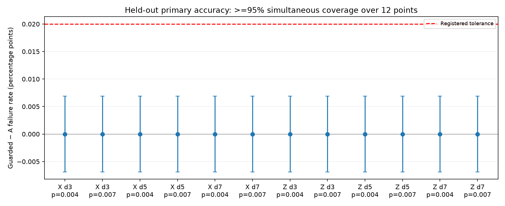
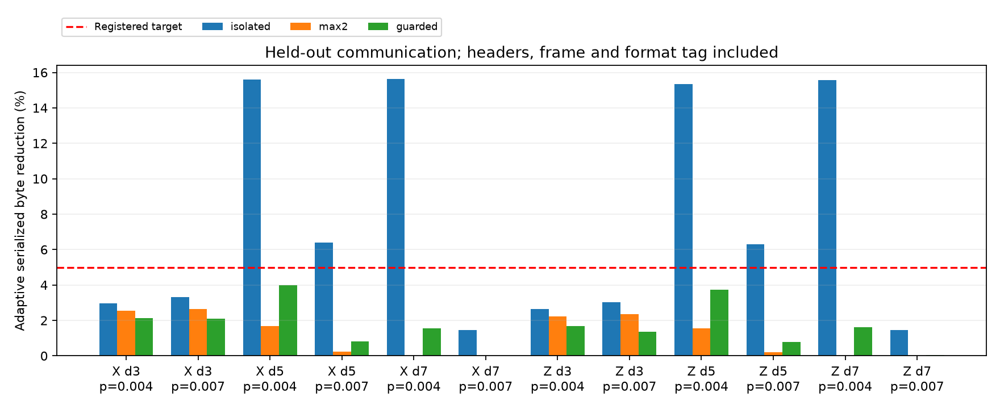
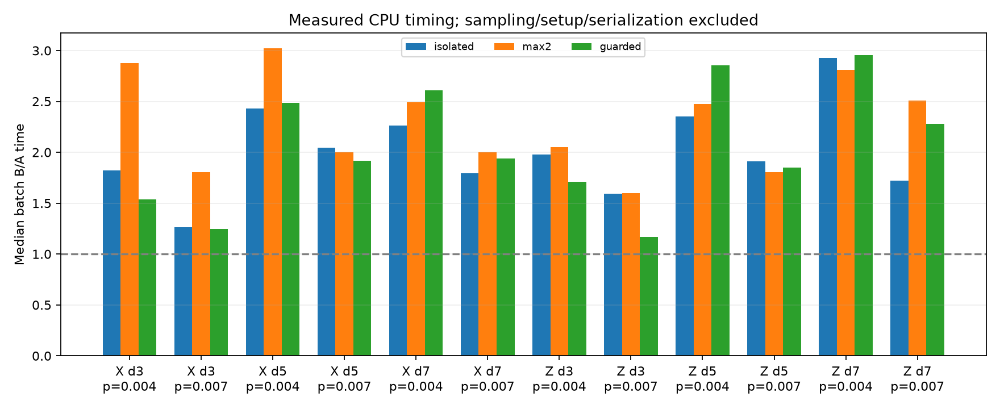

# F1 — frozen guarded predecoder evaluation

## Outcome

The guarded rule meets the registered accuracy criterion on this held-out grid,
but **does not meet the communication criterion and is not promoted to RTL**.
The thresholds were fixed before evaluation and were not relaxed afterward.
The M0–M6 report remains the historical baseline study; this report is a follow-up.

## Scientific purpose and design

M6 showed that a locally isolated detector pair can still be an incorrect global
choice. F1 adds a two-hop clear neighborhood around each chosen pair, and a
boundary-route cost margin of at least ln(10). The candidate must be a valid whole
two-detector DEM mechanism and agree with the merged matching graph's logical mask.
Ambiguous, unsupported or negative/nonfinite-weight cases fall back to MWPM.
The shared abstract boundary participates in the guard, which can make it large.

Costs come from the same weighted matching graph as the reference. The comparison
is a heuristic, not a calibrated 90% posterior confidence or a proof of optimality.
Corrections still XOR detector support and logical masks; final prediction is
predecoder frame XOR residual MWPM. A scalar reference and chunked batch kernel
implement the same rule. The existing RTL continues to implement the old rule.

## Preregistration and acceptance

[The plan](../../docs/F1_preregistration.md), fixed candidate, tests and config were
committed and pushed in **1e31675 before generating the held-out data**.
M6 examples were development data only. The separate smoke seeds were also not
part of the primary evaluation. No held-out threshold tuning or favorable rerun
selection occurred.

Primary grid: X/Z, d=3/5/7, rounds=d, p=.004/.007 in all four circuit noise
channels, 100,000 shots per point: **1,200,000** paired shots over 12 points.
Seed origin 202611060001 and per-point seeds/configs are archived. These physical
error parameters differ from the M6 development grid.

Accuracy target: upper bound on guarded minus baseline failure probability at
every primary point <=.0002, or **0.02 percentage points**. Conservative paired
exact intervals use alpha=.05/12, giving at least 95% simultaneous coverage for
the 12 guarded comparisons. The provisional tolerance is an engineering choice
for this experiment, not a general fault-tolerance requirement.

Communication target: at least **5% adaptive serialized-byte reduction at one
primary point**, together with accuracy passing at all primary points. Both
paths include the same header/frame and an explicit format tag. Timing is
descriptive. Promotion requires BOTH criteria.

## Held-out findings

| Policy | A-only failures | B-only failures | Adaptive saving range | Median batch B/A across points |
|---|---:|---:|---:|---:|
| M6 isolated | 516 | 1,128 | 1.45–15.63% | 1.94x |
| M6 strict max2 | 0 | 0 | 0–2.65% | 2.26x |
| F1 guarded | 0 | 0 | 0.027–4.003% | 1.93x |

These count totals describe a mixture of experimental points, not one universal
failure probability. A and the guarded rule each fail on the same 26,632 primary
shots: **zero prediction disagreements does not mean zero logical failures**.
The strict policy also agrees on these samples.

For each guarded primary point, the paired failure-rate change interval is
approximately [-.006867,+.006867] percentage points with the registered
simultaneous coverage. Its upper endpoint is below .02, so all 12 accuracy checks
pass. This bounds an allowed difference on the tested conditions; it does not
prove equivalence on every possible noise model or syndrome.



The best guarded saving is **4.0025%**, at X d=5, p=.004. It improves on the strict
policy's 1.67% at that point, while the original isolated policy saves 15.61% but
introduces extra failures. The guarded saving is still below the registered 5%
target. Its median saving across points is about **1.58%**. At larger/noisier
points it often does almost nothing.



Guarded batch processing is **1.17–2.96x slower** than baseline across points,
with median ratio 1.93x. Thus this candidate also demonstrates no CPU speedup.
Five warmed alternating trials use up to 4,096 saved windows. Times include the
batch kernel and residual decoding, but exclude sampling, graph compilation,
serialization and I/O. This shared Windows laptop is unpinned; five trials do
not support precise tail-latency or hardware-clock claims. Do not compare these
new-grid ratios as if they were matched performance measurements of the old M6 grid.



## Controls, development audit and limitations

Four stress points (X/Z d=5/7, rounds=2d, p=.007) add 200,000 paired shots. Guarded
predictions agree with baseline throughout. Savings are only about .12–.13% at
d=5 and zero at d=7. These are descriptive stress checks, outside the registered
primary family. Two noiseless d=3 X/Z controls add 20,000 shots, with zero failures
per 10,000 shots; each Wilson upper endpoint is .000384, not zero failure probability.

The biased development audit revisits 72 selected M6 B-only failure examples.
The guard retains 32 of their 379 original pair decisions, rejecting 347, and
makes no decision in 50 cases. This explains its conservatism on those examples;
it is not an unbiased population estimate or proof of a physical fault mechanism.

The result is a safety/traffic tradeoff. Large two-hop neighborhoods suppress
many local decisions. Boundary distances may share paths, and their cost margin
does not account for every competing explanation or correlation. No new RTL,
FPGA timing, power, queue or physical performance measurement is claimed. The
CPU kernel is a prototype and need not be the best possible implementation.

## Files, commands and actual checks

Added guarded.py, guarded_study.py, guarded_plots.py, tests/test_guarded.py,
configs/guarded.json, docs/F1_preregistration.md and scripts/package_guarded.py.
The paired interval now accepts alpha while preserving its M6 default. NetworkX
is an explicit research dependency. CLI command: guarded.

Using the Windows project `.venv/Scripts/python.exe`, from the repository root:

```text
python -m pytest --basetemp=results/f1-freeze-tests -q
python -m qec_project guarded --smoke
python -m qec_project guarded
python scripts/package_guarded.py results/e3620c5d6f574bb786db9c5baf7cd40a
```

Tests: **41 passed in 5.72 s**, including guard blocking, boundary competition,
negative-weight fallback, multi-observable XOR, batch/scalar equivalence and
correction reconstruction. The separate 500-shot-per-basis smoke completed.
Full evaluation completed all 18 primary/stress/control points, **1,420,000** shots,
with the original baseline, both old policies and the new rule on identical data.
The three standalone analysis figures were visually inspected.
CLI help and dependency checks passed. Archive verification confirmed the plan
hash matches the frozen manifest, all 1.42 million guarded prediction vectors
match baseline, and all 18 compressed candidate tables decode successfully.

Raw samples, truth, predictions, circuits, DEMs and per-point compiled guards:
`results/e3620c5d6f574bb786db9c5baf7cd40a`. Compact archive:
[reports/evidence/F1](../evidence/F1/verdict.json), including the frozen plan,
manifest, configs/candidates, environment/source hashes, CSV/JSON, failure
examples, summary and figures. The inherited manifest base-config seed belongs
to configs/smoke.json; actual sampling seeds are in the plan and every point
config/result row. This distinction does not change any sampled data.
Compiled candidate tables are losslessly archived as .json.gz to keep repository
size modest; uncompressed tables remain in the raw local run directory.

## Decision and next recommended step

**Do not promote F1 to RTL:** accuracy criterion passes, communication criterion
fails, and CPU speed is still worse. Keep it as a measured conservative reference.
The next experiment should use these results as development data to design a
more selective confidence test that preserves useful isolated components, then
freeze new criteria and use fresh evaluation samples. Reducing the guard radius
without checking competing paths could reintroduce the M6 failures. No new
candidate is silently implemented or retuned on this held-out grid.

Official API references: [PyMatching graph weights/edges](https://pymatching.readthedocs.io/en/stable/api.html)
and [Stim DEM semantics](https://github.com/quantumlib/Stim/blob/main/doc/file_format_dem_detector_error_model.md).
