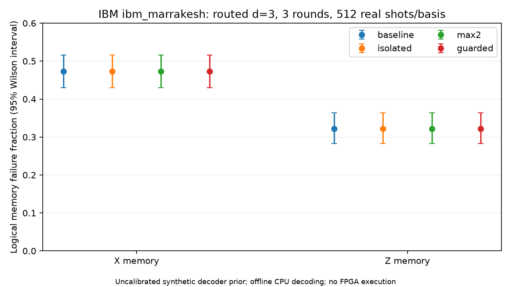

# H1 — first remote physical quantum-hardware pilot

## What actually ran

On 2026-11-06, IBM's **ibm_marrakesh** quantum processor executed one job with two
distance-3, three-round rotated surface-code memory circuits: **512 X-basis shots
and 512 Z-basis shots**. The client used the explicitly supplied Open/free instance,
verified allocation before submission and capped execution at 60 seconds. IBM
reported **3 seconds of QPU charge time**. No paid instance or billing setting
was enabled. The full job identifier remains private; the public provenance file
contains its digest and submission timestamp.

These are actual quantum-processor measurements, not simulator/dry-run output.
The Qiskit service used the remote IBM platform, the backend's simulator flag was
false, and SamplerV2 ran without dry_run. Decoding was performed afterward on the
laptop. **No physical FPGA executed our decoder, and no live feedback correction
was performed.** No locally owned hardware is needed for this remote-QPU path.

## Circuit conversion and preflight

Stim defines the circuit's detector parities and logical observable. A strict
converter maps supported ideal Clifford operations, reset and measurements to
Qiskit, compacting Stim's sparse qubit indices into **17 experiment qubits**.
It records each of the **33 chronological measurement bits** independently.
Qiskit bit strings are reversed into chronological classical-bit order before
Stim's own measurement-to-detector converter calculates **24 detectors and one
observable**. Synthetic noise instructions are explicitly rejected by conversion.
The device supplies the physical noise.

Tests verify noiseless X/Z behavior and X/Y/Z faults in both bases against Stim's
detector/observable predictions. The target supports optimized measure_2
mid-circuit measurements. Both fully transpiled circuits were also checked with
64 ideal stabilizer-simulator shots per basis: all detectors and observables
zero, as expected. These tests occurred before the physical job was submitted.

The backend has 156 qubits; the routed circuits use **18 physical qubits** in
instructions, including routing overhead. X depth is 318 and Z depth 313.
Each uses **312 CZ gates**, plus hundreds of single-qubit operations, 24
mid-circuit measurements, 9 terminal measurements and 41 resets. This is much
more hardware exposure than the ideal abstract circuit. No fixed syndrome-round
duration or target performance advantage is assumed.

## Measured outcome

The decoder prior is the same style of synthetic Stim DEM with all four noise
probabilities set to .005. It is **not calibrated to this device or its routed
circuit**, and does not capture all physical correlations, readout, leakage,
drift, extra routing or idle errors.

| Basis | Shots | Raw logical-parity flips | MWPM memory failures | Failure fraction | 95% Wilson interval |
|---|---:|---:|---:|---:|---:|
| X | 512 | 243 | 242 | 47.27% | 42.98–51.59% |
| Z | 512 | 195 | 165 | 32.23% | 28.32–36.39% |

Mean detector-event counts are 8.164/window for X and 7.432/window for Z. The
isolated, max2 and guarded predecoder variants produce the **same observable
predictions as baseline MWPM** on these shots. This small sample does not establish
equivalence; the conservative paired interval on added failure probability is
approximately +/-0.852 percentage points for zero disagreements at 512 shots.



These poor rates do not demonstrate a quantum-error-correction advantage. The
experiment validates physical access, circuit execution, raw-record conversion
and offline decoder scoring. It does not establish below-threshold operation,
an encoded-versus-unencoded advantage, successful real-time feedback, or a new
hardware speedup. The high rates may reflect substantial routing/noise and model
mismatch; this pilot does not causally isolate those contributions. Comparing
raw parity to decoded parity is not an unencoded-memory control.

## Credential protection and commits

api.txt and crn.txt remain local and ignored, along with private/, environment
files and SDK credential directories. The client never calls save_account, puts
keys in command arguments, or prints raw SDK exceptions. Public exports whitelist
research fields and check for credential values. A pre-commit hook checks the
staged tree and normal branch histories against the local values and common URL
encodings. Synthetic tests demonstrate it blocks staged credentials without
echoing them. Tests also cover free-plan/allocation refusal and duplicate jobs.

Initial broad inspection found copies in an app-managed **local Codex snapshot**,
created before the ignore rule. No credential paths were tracked by main or its
remote-tracking history. Exact-value scans passed for normal branch histories.
Only main was pushed, never app refs or a mirror. No history rewrite or snapshot
deletion was performed. See [private access instructions](../../docs/private_access.md).

Checkpoints: **4b88c1c** added credential protection and the read-only probe;
**8f9782e** saved the validated bridge/pilot before submission. Results and further
budget guards are saved in the subsequent H1 evidence commit. The older M5/M6
FPGA work remains simulation and generic synthesis.

## Actual checks and commands

Project Windows Python, from repository root:
```text
python scripts/check_secrets.py --history
python -m qec_project.ibm_access probe
python -m pytest tests/test_qiskit_bridge.py --basetemp=results/ibm-bridge-tests -q
python -m qec_project.ibm_experiment prepare
python -m qec_project.ibm_experiment submit --run PRIVATE_RUN_DIRECTORY
python -m qec_project.ibm_experiment fetch --run PRIVATE_RUN_DIRECTORY
python -m pytest --basetemp=results/ibm-final-normal-process-tests -q
python -m pytest --basetemp=results/h1-acceptance-tests -q
python scripts/package_ibm_pilot.py PRIVATE_RUN_DIRECTORY
```
The private run directory and complete job ID are not exported publicly.
Only one hardware job was submitted; status/result reads submitted nothing new.
The probe confirmed Open/free access and remaining allocation after completion.

The final acceptance suite passed **57 tests in 17.40 s** in a normal Windows process
with OMP_NUM_THREADS=1 and TMP/TEMP pointing to results. An earlier restricted
process failed while initializing Aer's native DLL during test collection; the
normal-process rerun passed 56 tests, before the additional forced-private-file
blocking test was added. The earlier 54-test preflight suite and routed
ideal validation had already passed before submission. Dependency consistency
and credential scans passed. CLI operations suppress raw authentication errors;
an initial restricted network probe failed and succeeded with normal network access.

## Evidence and reproduction

Public [evidence/H1](../evidence/H1/summary.json) contains sanitized preparation,
summary, provenance digest, ideal reference circuits, approximate DEMs, a real
measurement plot and **actual raw measurement/detector/observable arrays and
decoder predictions** in X-measurements.npz and Z-measurements.npz. Exact routed
QPY circuits, local job record and credentials remain private. requirements-ibm-lock.txt
records the environment; versions include Qiskit 2.6.2, Runtime 0.51.0, Aer 0.18.2,
Stim 1.16.0 and PyMatching 2.4.0.

Install `.[dev,research,ibm]` and follow docs/private_access.md to prepare a new
bounded run. That would submit a new job and use additional free allocation;
it is not needed to inspect or re-score existing data. Physical measurements
will not be bitwise reproducible because hardware noise and calibration change.

## Next recommended step

Before spending more allocation, replay and audit these measured detector records,
add physical initialization/readout controls, inspect layout/routing overhead and
build a better hardware-specific prior using separate calibration/training data.
Any later accuracy comparison needs independent evaluation samples and appropriate
uncertainty. Acquiring an FPGA is optional; access to IBM's QPU cannot load our
SystemVerilog design onto an FPGA. This pilot meets the real-quantum-data goal,
while the FPGA implementation question remains a separate hardware route.
