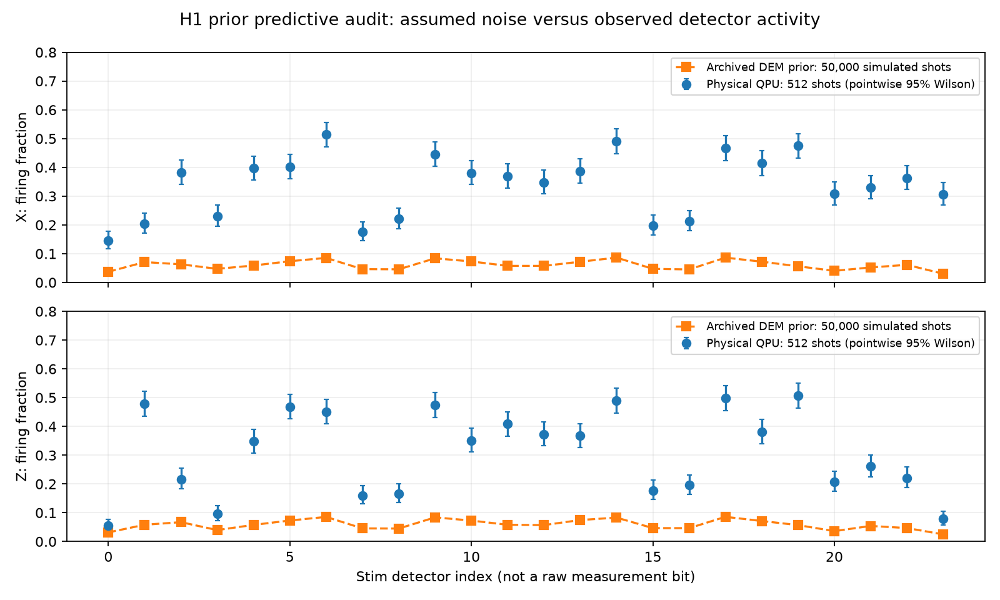

# H2 — offline physical-data and decoder-prior audit

This checkpoint diagnoses H1 without submitting another quantum job or reading
credentials. It does not change the decoder or tune weights on evaluation labels.
The original project studies the **classical decoding architecture** within surface-code
QEC; H1 extended that study to physical quantum measurements, decoded offline.

## Measured findings

All saved raw measurements reproduce the archived Stim detectors, observables and
MWPM predictions exactly. The predecoder variants still predict the same logical
frames as MWPM on these 1,024 physical shots.

| Quantity | X memory | Z memory |
|---|---:|---:|
| Physical shots | 512 | 512 |
| Mean physical detector events/window | 8.164 | 7.432 |
| Mean events from archived prior, 50,000 simulated shots | 1.449 | 1.401 |
| Physical outcomes fixed by MWPM versus zero frame | 89 | 101 |
| Physical outcomes spoiled by MWPM versus zero frame | 88 | 71 |
| Physical decoded failures | 242 | 165 |
| Failures on simulated prior samples | 975/50,000 | 870/50,000 |

The prior predicts roughly five to six times fewer detector events than observed.
This is direct evidence that the assumed detector distribution does not describe
the physical experiment well. It does **not** identify a unique physical cause or
prove that changing weights alone can recover the information already lost.

In X memory, 89 fixes nearly cancel 88 spoiled outcomes. In Z memory the net
improvement is 30 outcomes. Conservative paired 95% intervals for decoded minus
zero-frame failure probability are [-7.87, +7.48] percentage points (X) and
[-13.36, +1.73] points (Z); both include zero. A zero-frame prediction means
making no inferred observable-frame change on the **same encoded experiment**.
It is not an unencoded physical-memory control and establishes no QEC advantage.

Both ideal circuits contain 72 abstract CX gates; each routed hardware circuit
contains 312 CZ gates, a count ratio of 4.33. This measures compilation overhead,
not a 4.33-fold error increase: gate types, durations and errors differ. Together
with the detector activity mismatch it motivates layout and physical-noise work.
The simulator results are samples from the archived synthetic DEM itself, not
a calibrated simulation of the routed device.



## Implementation and reproducibility

`src/qec_project/hardware_audit.py` provides a standalone offline CLI using only
public evidence. It verifies raw-record conversion and predictions, records input
SHA-256 hashes, partitions helped/hurt outcomes, summarizes event-count strata,
samples the archived DEM with seed 20261107 (Z uses seed+1), and plots each
detector's firing fraction. Physical error bars are pointwise Wilson intervals;
detectors are correlated and the plot is not a collection of independent tests.
No fitting or multiple-testing discovery claim is made. The existing hardware
records are now development data; future decoder validation needs fresh shots.

From the repository root, commands actually run:

```powershell
.\.venv\Scripts\python.exe -m pytest tests/test_hardware_audit.py -q --basetemp=results/h2-tests
.\.venv\Scripts\python.exe -m qec_project.hardware_audit --output reports/evidence/H2
$env:OMP_NUM_THREADS='1'
$env:TMP=(Resolve-Path results).Path
$env:TEMP=$env:TMP
.\.venv\Scripts\python.exe -m pytest -q --basetemp=results/h2-acceptance-local-temp
```

The two new tests check paired category bookkeeping and actual archived hardware
replay. The first full-suite attempt passed 56 tests but failed three Sinter tests
because the restricted Windows temporary directory was inaccessible. The rerun
uses a writable project-local temporary directory and passed **59 tests in 6.29 s**.
The generated JSON and visually checked PNG are under
`reports/evidence/H2/`; the CLI defaults to ignored `results/h1-audit/` for normal use.

## Next focused checkpoint

Prepare and validate initialization/readout and short unencoded-memory controls,
then compare routing/layout candidates before another bounded physical run.
Controls must distinguish basis preparation, final measurement and repeated-check
exposure; durations and qubit mapping must be recorded. Any hardware-specific prior
must use separate calibration/training data and be frozen before independent
evaluation. No physical FPGA or new QPU allocation was used in H2.
